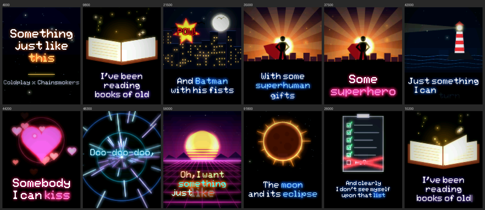

# Lyrics on the Screen: "Something Just Like This"

A cinematic, animated lyric video for **"Something Just Like This"** by **Coldplay & The Chainsmokers**, rendered live on a **128x160 ST7735 SPI TFT** by an **ESP32-S3**, in pure C.

There are no images, no video files and no graphics libraries. Every frame (illustrations, glowing kinetic typography, beat-synced drops) is computed from the song position about 25 times a second.



> **How is this possible?** The full strategy (drawing engine, scenes, typography, and the dual-core pipeline that makes it fast) is documented in **[docs/HOW_IT_WORKS.md](docs/HOW_IT_WORKS.md)**.

---

## 📌 Hardware Wiring

| Signal | ST7735 Pin | ESP32-S3 GPIO | Description |
|---|---|---|---|
| **MOSI / SDA** | SDA / SDI | **GPIO 38** | SPI Data out |
| **SCLK** | SCK / CLK | **GPIO 39** | SPI Clock |
| **CS** | CS | **GPIO 40** | Chip Select |
| **DC** | DC / A0 / RS | **GPIO 41** | Data / Command |
| **RST** | RES / RESET | **GPIO 42** | Hardware Reset |
| **BL** | BL / LED | **GPIO 47** | Backlight (PWM Dimming) |
| **VCC** | VCC | **3.3V** | Display Power (3.3V) |
| **GND** | GND | **GND** | Ground |

---

## ✨ Features

- **Full song, synchronized**: every line of the official 4:07 track, timed to the millisecond.
- **An animated illustration for every lyric**, in original neon line art:

  | Lyric | Scene |
  |---|---|
  | *books of old* | an open book flipping its pages as magic dust rises |
  | *legends and myths* | a Greek temple drawing itself in |
  | *Achilles and his gold* | a golden shield and spear with a shine sweep |
  | *Hercules* | storm clouds and lightning strikes |
  | *Spider-Man's control* | a web spinning out as a spider lowers itself |
  | *Batman with his fists* | a night skyline, bats across the moon, a comic **POW!** |
  | *upon that list* | a checklist that ends with a red X over "me?" |
  | *where'd you wanna go* | a road into the sunset with a map pin dropping in |
  | *how much you wanna risk* | dice tumbling across the floor |
  | *superhero / superhuman* | a caped silhouette on a rooftop against sun rays |
  | *fairytale bliss* | a castle with a wand trail and fireworks |
  | *something I can turn to* | a lighthouse sweeping its beam |
  | *kiss / miss* | a beating heart with floating hearts |
  | *something just like this* | particles swirling together into a heart |
  | *the moon and its eclipse* | a blood-moon eclipse |
  | *before he lifts* | a hero launching into the sky |
  | **drops** | hyperspace warp tunnel and a synthwave sun over a neon grid |
  | **guitar solo** | oscilloscope waves |
  | **intro / outro** | a starry sky with shooting stars |

- **Cinematic camera**: a slow push-in on every shot, fades through black between scenes, and lines that share a scene continue as one shot. A vignette frames everything.
- **Drops hit hard**: hard cuts, white flash hits, a beat-synced zoom punch and screen shake, color-cycling words, and shockwaves at 103 BPM.
- **Kinetic typography**: words appear one by one as they're sung (rise, pop or typewriter, depending on the line). The word just sung flares brighter, and accent words are highlighted.
- **Real colored bloom**: anti-aliased shapes and an EPX-smoothed proportional font, with neon glow that objects in front can block.
- **Runs smoothly on the chip**: a two-core pipeline (core 1 draws, core 0 adds bloom and streams to the display over DMA), with live FPS and timing logs.
- **PC preview tools**: render any moment of the video to a PNG without flashing the board ([tools/preview](tools/preview/README.md)).

---

## 🎮 Controls

**BOOT button (GPIO 0)**
- Short click: **Play / Pause**
- Hold (>1.2 s): **Restart from 00:00**

**Serial monitor (115200 baud)**
- `Space`: Play / Pause
- `r`: Restart from the beginning
- `+` / `-`: Nudge time ±2 s (to line up with music playing on your phone)
- `0`..`9`: Jump to 0%, 10%, ... 90% of the song

To sync with real audio, start the song and the board at the same moment, then nudge with `+`/`-`.

---

## 🚀 Build & Flash

```powershell
# Build firmware
pio run

# Flash to ESP32-S3
pio run --target upload

# Serial monitor: live lyrics, controls, and performance stats
pio device monitor
```

Every ~10 seconds the monitor prints the frame rate and render cost per core:
```
25.0 fps | draw (core 1) avg … / max … ms | finish (core 0) avg … / max … ms | budget 40 ms
```
The project expects the CPU at **240 MHz** (set in `sdkconfig.esp32-s3-devkitm-1`). The renderer is always compiled with `-O2 -ffast-math`; see [src/CMakeLists.txt](src/CMakeLists.txt).

---

## 🎬 Customize

Every line lives in [include/lyrics_data.h](include/lyrics_data.h):

```c
{36000, "Some|*superhero*", LS_CHORUS, SC_HERO},
//  ms    text + markup     text style  scene
```

- **Text markup**: `|` forces a line break, and `*word*` uses the accent color.
- **Text styles**:

  | Style | Look |
  |---|---|
  | `LS_VERSE` | words float up |
  | `LS_TYPE` | typewriter |
  | `LS_CHORUS` | big words pop in |
  | `LS_DROP` | beat-synced and color-cycling |
  | `LS_TITLE` | title card |
  | `LS_BREAK` | small caption |

- **Scenes**: `SC_BOOK`, `SC_TEMPLE`, `SC_SHIELD`, `SC_LIGHTNING`, `SC_WEB`, `SC_CITY`, `SC_LIST`, `SC_ROAD`, `SC_DICE`, `SC_HERO`, `SC_CASTLE`, `SC_LIGHTHOUSE`, `SC_HEART`, `SC_HEARTFORM`, `SC_MOON`, `SC_LIFTOFF`, `SC_WARP`, `SC_GRID`, `SC_WAVE`, `SC_STARS`, or `SC_NONE` for text only. They're described in [include/lyric_types.h](include/lyric_types.h).
- **Tempo**: `SONG_BPM` sets the beat pulse.
- **Feel**: fade and hold timings, plus an optional progress line, are set at the top of [src/lyric_fx.c](src/lyric_fx.c).

To add your own scene, see [docs/HOW_IT_WORKS.md, section 9](docs/HOW_IT_WORKS.md#9-changing-things).

---

## 🗂 Project Layout

```
include/
  lyrics_data.h   the song: timing, text, style, scene per line
  lyric_types.h   style + scene enums
  lyric_fx.h      renderer API (two-stage draw / finish)
  fx_draw.h       drawing engine API
  scenes.h        scene API
  font5x7.h       the bitmap font
src/
  main.c          ST7735 + DMA, dual-core pipeline, watchdog, controls
  lyric_fx.c      frame director: timing, camera, transitions, kinetic text
  scenes.c        the 20 animated illustrations
  fx_draw.c       software rasterizer: AA shapes, smoothed text, bloom, vignette
tools/preview/    build the renderer on a PC: PNG previews + benchmarks
docs/             how it works, preview images
```
