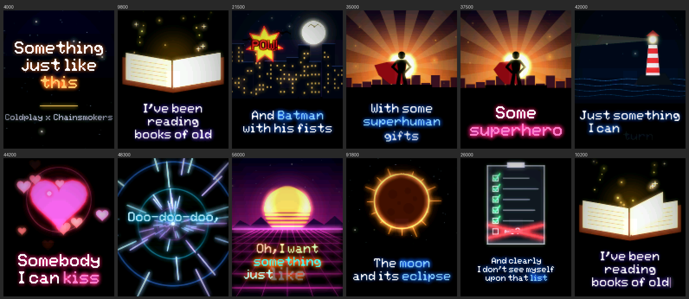
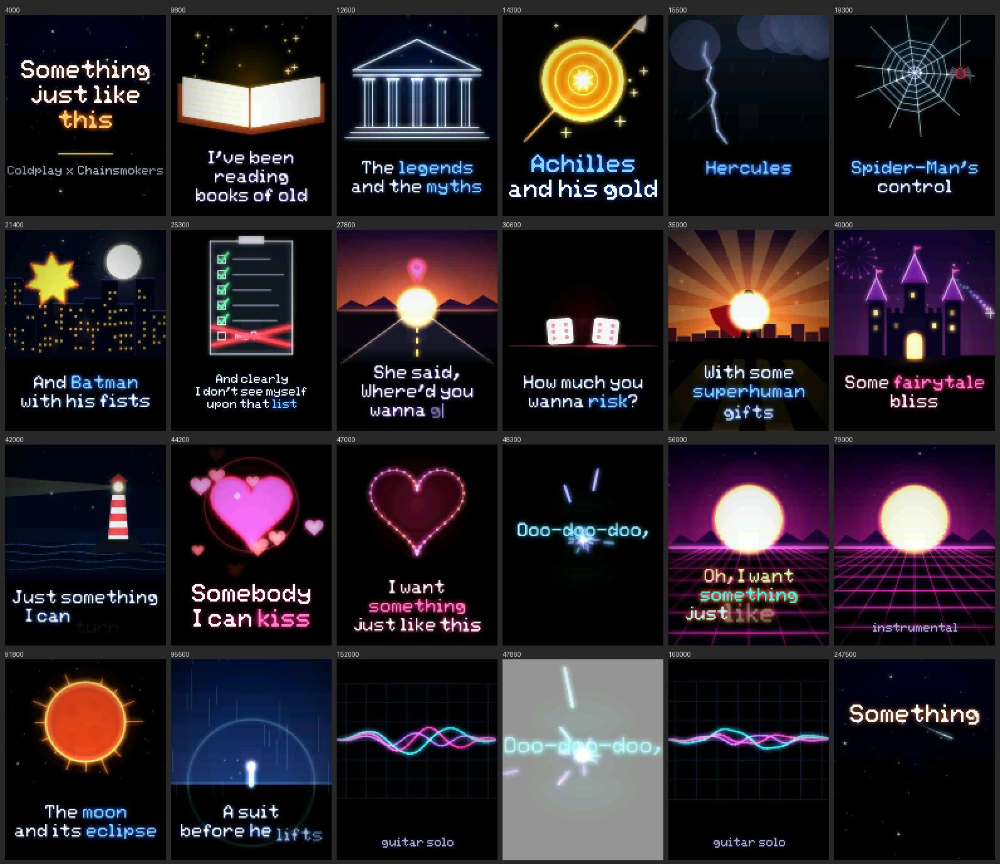

# How it works: a lyric video in pure C

This project plays an animated, cinematic lyric video on a 128×160 ST7735 screen driven by an ESP32-S3. There are **no images, no video files and no graphics libraries** in it. Every frame is drawn from scratch about 25 times a second, by code that turns the song position (in milliseconds) into pixels.

This document explains the strategy behind it, from the big picture down to the tricks that make it fast enough for a microcontroller.



---

## 1. The big idea: a frame is a function of time

Video normally means storing frames. Here nothing is stored; each frame is *computed*:

```
frame = render(song_ms)
```

Everything on screen is a pure function of `song_ms`:
- which lyric line is active, and how long ago it started;
- how far each word has animated in;
- where the camera is, what the beat is doing, and how far each scene's animation has progressed.

This has nice consequences:
- **Seeking is free.** Jump to 1:30 and the renderer draws exactly what 1:30 looks like, with no "replaying" needed.
- **It's tiny.** The whole video, all 20 illustrated scenes included, adds only about 40 KB of code.
- **Everything is editable.** A scene is a recipe of numbers (positions, colors, speeds) you can tweak.

The only state that carries over between frames is a cached text layout and a few ambient background particles.

---

## 2. Architecture

```
            include/lyrics_data.h  ── start time, text, style, scene for every line
                       │
                       ▼
 src/lyric_fx.c   ──  the director: timing, beat, camera, fades, text animation
     │      │
     │      └──────►  src/scenes.c   ── 20 animated illustrations (book, hero, warp...)
     ▼                     │
 src/fx_draw.c  ◄──────────┘          ── the drawing engine: anti-aliased shapes,
     │                                   smoothed font, colored bloom, camera, vignette
     ▼
 src/main.c     ──  hardware: ST7735 over SPI+DMA, two-core pipeline, buttons, serial
```

| File | Role |
|---|---|
| [include/lyrics_data.h](../include/lyrics_data.h) | The song: each line's start time, text (with markup), text style and scene. |
| [include/lyric_types.h](../include/lyric_types.h) | The style (`LS_*`) and scene (`SC_*`) enums. |
| [src/lyric_fx.c](../src/lyric_fx.c) | Puts each frame together: timing, layout, word animation, camera, fades, drop effects. |
| [src/scenes.c](../src/scenes.c) | One function per illustration, all built from engine primitives. |
| [src/fx_draw.c](../src/fx_draw.c) | Software rasterizer: shapes, text, glow, vignette, camera. |
| [src/main.c](../src/main.c) | Display driver, DMA, the dual-core frame pipeline, controls. |
| [tools/preview/](../tools/preview/) | Builds the same renderer on a PC to produce PNG previews and benchmarks. |

The renderer (`lyric_fx.c`, `fx_draw.c`, `scenes.c`) has **no hardware dependencies**. It only writes into a `uint16_t` array. That separation is what made it possible to develop and check the visuals on a PC (see [section 8](#8-developing-without-the-hardware)).

---

## 3. The drawing engine ([fx_draw.c](../src/fx_draw.c))

### 3.1 The framebuffer

The screen is a plain array of `128 × 160 = 20,480` pixels in RGB565 (5 bits red, 6 green, 5 blue). Drawing anything means changing numbers in that array. Two blend operations do almost all the work:

- **alpha blend** (`fx_blend`): paint a color over a pixel with some opacity;
- **additive light** (`fx_add`): add light to a pixel, saturating at white. It's used for glows, light rays and stars.

### 3.2 Anti-aliased shapes

A low-resolution screen looks jagged unless edges are smooth. Each primitive therefore computes **how much of each pixel the shape covers** (0–100%) and blends by that amount.

| Primitive | How coverage is computed |
|---|---|
| `fx_disc` (circle) | Distance from the pixel center to the circle center vs. the radius. Pixels within ±0.5 px of the edge get partial coverage. |
| `fx_ring`, `fx_arc` | Distance from the ring's center line; arcs also test the pixel's angle. |
| `fx_line` (thick line) | Distance from the pixel to the line segment, i.e. a "capsule" shape with round ends. |
| `fx_poly` (any polygon) | Scanline fill with **4 sub-scanlines per pixel row** and exact horizontal coverage at the span ends. |
| `fx_radial` | Soft additive light with a `(1 − d²/r²)⁴` falloff: a glowing blob. |
| `fx_vgradient` | A vertical color gradient (skies). |

Everything else is built from these: a heart is a polygon, a die is a rotated octagon with discs for pips, and a lightning bolt is a chain of lines.

### 3.3 Text: a 5×7 font that doesn't look like one

The only font is a classic 5×7 bitmap font. Three tricks make it look good at large sizes:

1. **EPX / Scale2x smoothing.** At startup, each glyph is upscaled to 10×16 with the EPX rule: a corner pixel is filled in when its two neighbors agree. This rounds off staircase diagonals.
2. **Supersampled rendering at any scale.** Each glyph pixel is sampled at 3×3 points against the smoothed bitmap. That gives anti-aliased letters at any size, including fractional sizes during zoom animations.
3. **Proportional spacing.** Each glyph's real inked width is measured, so an `i` takes less room than an `m`.

### 3.4 Bloom (the neon glow)

The neon look is a real bloom effect, done in three steps:

1. While drawing, every shape and glyph can also write its color, scaled by a glow amount, into a separate **glow layer**.
2. At the end of the frame, the glow layer is **blurred**: a box blur applied twice, which approximates a Gaussian.
3. The blurred glow is **added** on top of the frame.

Two refinements make it look right:
- **Occlusion:** when an opaque shape is drawn, it reduces the glow already underneath it. That's why the black superhero silhouette stays black in front of a blazing sun instead of being washed out.
- **Text protection:** pixels covered by lyric text don't receive bloom from behind, so the words stay crisp and readable.

The glow layer runs at **half resolution** (64×80, three color channels) and is upscaled bilinearly when it's added back. Glow is blurry by nature, so this looks the same at a quarter of the cost.

### 3.5 Camera and vignette

Scene drawing goes through a tiny **camera** (zoom + center + shake offset) that transforms world coordinates to screen coordinates. That gives the slow cinematic push-in, the zoom "punch" on drop beats, and the screen shake on the comic POW.

A **vignette** darkens the edges of the frame slightly, using two small precomputed lookup tables (one per axis).

---

## 4. Scenes ([scenes.c](../src/scenes.c))



Each scene is a function that receives the time since its shot began (`t`) and a few beat values. It issues draw calls whose parameters depend on `t`. For example:

**The heart that forms from particles**, for "something just like this":
```c
// a point on the classic heart curve
x = 16·sin³(u)
y = 13·cos(u) − 5·cos(2u) − 2·cos(3u) − cos(4u)
```
44 particles start at random positions (taken from a hash, so they're the same every time). As `t` goes from 0 to 1.7 s they ease toward 44 points on that curve while the whole cloud un-rotates. Once the heart is formed, its outline fades in and sparkles appear.

**The superhero**, for "some superhero":
- a sky gradient and a sun that rises over 5 seconds;
- 14 light-ray triangles rotating slowly around the sun;
- a distant city made of random-height rectangles;
- a black silhouette (a disc for the head, polygons for the body);
- a red polygon cape whose trailing points move with `sin(t)`;
- embers drifting upward.

Other techniques used across the scenes:
- **Draw-on animation:** lines grow from 0 to full length over time, so the temple and the spider web build themselves.
- **Fake perspective:** the road's center dashes and the synthwave grid use `y = horizon + k·u²` with `u` scrolling, so they speed up as they approach.
- **Deterministic randomness:** `fx_hashf(i)` returns a repeatable pseudo-random number per index. Stars, windows, rain and fireworks look random but are stable from frame to frame, with no stored state.
- **Periodic events:** lightning strikes, shooting stars and fireworks fire on a period such as `t mod 1150 ms`, and the period index seeds the randomness so each event looks different.
- **Easing curves:** `ease_out`, `ease_back` (overshoot) and `bounce` make motion feel physical, like the map pin bouncing or the shield popping in.

### Shots and transitions

Consecutive lines that use the same scene are treated as **one continuous shot**. The scene time `t` starts at the first line of the run, so the superhero keeps standing there across three lines instead of restarting. Scene changes **fade through black** over 450 ms. Drop sections use **hard cuts** with a white flash instead.

### Where the text goes

Each scene declares a layout class:

| Layout | Scenes | Lyric placement |
|---|---|---|
| `SL_ILLUS` | most illustrations | lower third (y ≈ 129), max scale 2, dark backdrop band |
| `SL_FLOOR` | synthwave grid, oscilloscope | over the "floor" (y ≈ 120), backdrop band |
| `SL_FULL` | stars, warp | centered, large |

---

## 5. Kinetic typography ([lyric_fx.c](../src/lyric_fx.c))

**Layout.** Each line is parsed into words. `|` forces a line break and `*` toggles the accent color. The layout picks the **largest scale that fits** (3.0, 2.5, 2.0, ... down to 1.0) within the width and height allowed by the scene, then centers each row. The result is cached per line.

**Timing.** A line's words are revealed over `min(72% of the line's duration, characters × 70 ms)`. Each word appears when the "singing cursor" reaches its first character, so long words take proportionally longer. Text fades out 280 ms before the next line, or after holding for 4 s if there's a long instrumental gap.

**Per-style animation:**

| Style | Word entrance |
|---|---|
| `LS_VERSE` | floats up 10 px and fades in (320 ms, ease-out) |
| `LS_TYPE` | typewriter: letter by letter, with a blinking cursor |
| `LS_CHORUS` | pops in from 155% size |
| `LS_DROP` | zooms in from up to 190% (capped so long words stay on screen), pulses on every beat, hue-cycles, and zooms out through the camera on exit |
| `LS_TITLE` | slow, elegant fade and settle |
| `LS_BREAK` | small caption under a scene |

The **word just sung glows brighter**: the glow decays as `e^(−dt/380ms)`, which gives a karaoke-like highlight without any extra state.

**The beat.** The song runs at 103 BPM, so the beat phase is `t mod 582.5 ms` measured from the line's start, and the pulse is `e^(−phase/140ms)`. The pulse drives the drop zoom punch, the shake, the bloom boost, the warp and grid speed, and the heart beat.

---

## 6. Making it fast enough for a microcontroller

The budget is **40 ms per frame** (25 FPS). The first version took **54 ms on average and 95 ms at worst** on the device. It also never yielded the CPU, which tripped the task watchdog. Here's what fixed it.

### 6.1 Two cores, pipelined

The ESP32-S3 has two cores, and originally one did nothing. Rendering is now split into two stages that run on different cores at the same time:

```
time ──────────────────────────────────────────────────────────►
core 1 (draw):    [ draw frame N ][ draw frame N+1 ][ draw N+2 ] ...
core 0 (finish):          [ bloom+vignette N ][ bloom+vignette N+1 ] ...
SPI DMA:                          [ send frame N  ][ send frame N+1  ] ...
```

- **Core 1** (`draw_task`) runs the playback clock and input, and draws the scene and lyrics (`fx_draw_frame`).
- **Core 0** (`app_main`) blurs and adds the glow, applies the vignette, flashes and overlays (`fx_finish_frame`), then starts the DMA transfer.
- Two framebuffers and two "slots" of glow and coverage buffers circulate through a pair of FreeRTOS queues (`free → draw → ready → finish/send → free`). No frame is ever written while it's still being sent.

### 6.2 DMA instead of waiting on SPI

Pushing 40,960 bytes at 15 MHz takes about 22 ms. The frame is queued as ten 4 KB DMA transactions, and the CPU goes straight back to work while the SPI hardware streams it out.

### 6.3 Doing less work per pixel

| Optimization | Why it matters |
|---|---|
| **Half-resolution glow** (64×80) with bilinear upscale | The blur was the top hotspot in the device backtraces; this makes it 4x cheaper. |
| **No per-pixel square roots** | Discs, rings and lines compare *squared* distances, and only edge pixels compute a real `sqrt`. Radial lights use a sqrt-free falloff. |
| **Polygons only touch covered pixels** | Big shapes like the sun rays used to scan their whole bounding box. |
| **Fast-path fills** | Opaque gradient rows are written directly, with no blending. |
| **`-O2 -ffast-math` for the renderer only** | The project builds with `-Og` (debug) by default; [src/CMakeLists.txt](../src/CMakeLists.txt) overrides it for the three renderer files. |
| **CPU at 240 MHz** | The sdkconfig had 160 MHz even though `platformio.ini` asked for 240. |

On the PC benchmark, these changes made drawing about **2.4x faster** (the heaviest scene went from 547 µs to 247 µs), and bloom now runs in parallel on the other core.

### 6.4 The watchdog

The task watchdog normally checks that each core's idle task gets to run. Core 1 now draws as fast as it can, so the firmware reconfigures the watchdog with `esp_task_wdt_reconfigure` to watch only core 0's idle task. The draw task subscribes itself and feeds the watchdog every frame, so a real hang on core 1 is still caught.

### 6.5 Measuring

Every ~10 s the firmware logs:
```
25.0 fps | draw (core 1) avg … / max … ms | finish (core 0) avg … / max … ms | budget 40 ms
```
If a scene goes over budget, this line tells you which core is the bottleneck.

### 6.6 Memory

Everything lives in static internal RAM, with no `malloc` and no PSRAM:
- two framebuffers (80 KB);
- two glow/coverage slots (about 70 KB);
- a few small tables.

Total RAM use is about 58%.

---

## 7. A frame, start to finish

1. **Core 1** reads the clock and finds the active lyric line, then computes the line time, scene-shot time, beat phase and fades.
2. It sets up the camera (push-in, beat zoom, shake) and calls the scene function, which draws the illustration into the framebuffer and the glow layer.
3. It darkens a soft band behind where the lyrics go, then draws each revealed word with its entrance animation, accent colors and glow.
4. It hands the frame to **core 0**, which blurs the glow, upscales it and adds it, then applies the vignette, any drop flash and the pause icon.
5. Core 0 byte-swaps the frame for the ST7735 and queues it to SPI DMA, then returns the previous buffer to core 1.

---

## 8. Developing without the hardware

The visuals were built without seeing the physical screen:

1. Because the renderer only writes to an array, it compiles unchanged on a PC. Zig's C compiler was installed from pip for this.
2. A small harness ([tools/preview/preview.c](../tools/preview/preview.c)) renders frames at chosen song times to a raw file.
3. A Python script ([make_sheet.py](../tools/preview/make_sheet.py)) converts them into a PNG contact sheet.
4. Looking at those sheets caught real bugs before they ever reached the device:
   - the bloom washing out the superhero silhouette, which is what led to glow occlusion;
   - "POW!" being unreadable on its starburst;
   - the sun peeking out below a rooftop;
   - drop words zooming off-screen;
   - stray dialogue quote marks in the lyrics.
5. A benchmark ([bench.c](../tools/preview/bench.c)) compared scenes and confirmed each optimization. The device's own timing log is the final authority.

See [tools/preview/README.md](../tools/preview/README.md) to run them yourself.

---

## 9. Changing things

### Retime or restyle a line
Edit its entry in [include/lyrics_data.h](../include/lyrics_data.h):
```c
{36000, "Some|*superhero*", LS_CHORUS, SC_HERO},
//  ms    text + markup     text style  scene
```
- If the whole display runs early or late against the audio, use the `+`/`-` serial keys to find the offset, then shift the times.
- `SONG_BPM` sets the beat pulse.

### Add a new scene
1. Add an `SC_YOURSCENE` value to the enum in [include/lyric_types.h](../include/lyric_types.h).
2. Write `static void sc_yourscene(const scene_ctx_t *c)` in [src/scenes.c](../src/scenes.c), drawing with `fx_*` calls based on `c->t` (ms into the shot) and `c->pulse` (beat).
3. Add it to `scene_draw()`. If it should be a full-screen background, also add it to `scene_layout()`.
4. Use it in `lyrics_data.h`, preview it with the PC tools, then check the device timing log.

Keep illustrations in roughly y = 0..100, since the lyrics sit below that.

### Tune the feel
The constants at the top of [src/lyric_fx.c](../src/lyric_fx.c) control the feel:

| Constant | Controls |
|---|---|
| `EXIT_MS` | text fade-out time |
| `MAX_HOLD_MS` | how long text holds before fading |
| `SCENE_FADE_MS` | scene cross-fade time |
| `SHOW_PROGRESS_LINE` | optional hairline progress bar |
